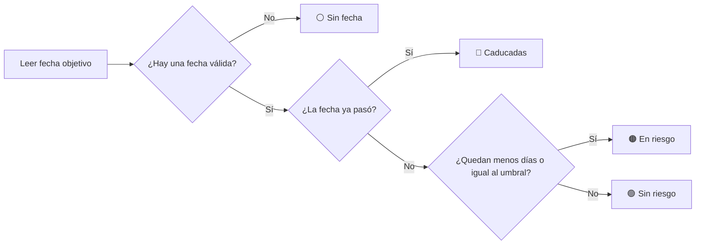
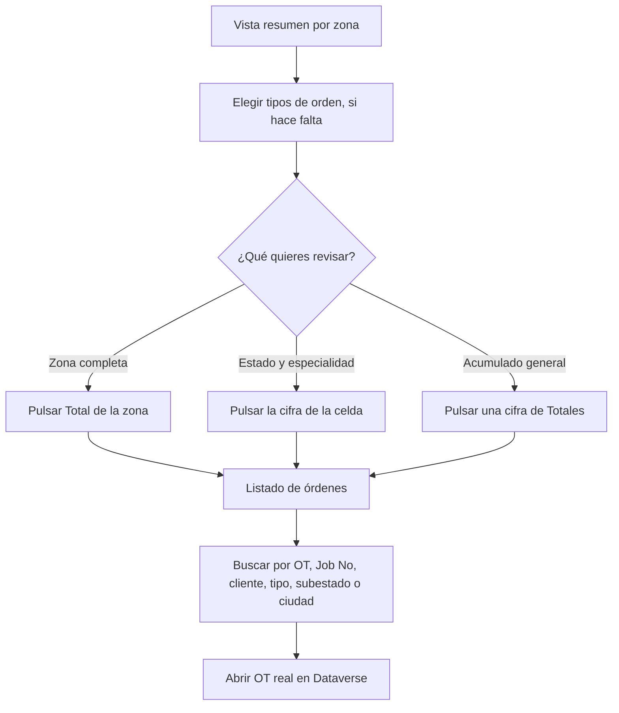

# 📊 Control de Órdenes de Trabajo

<p align="center">
  <strong>Una vista rápida y accionable del estado de las órdenes de trabajo por zona, especialidad y fecha límite.</strong>
</p>

<p align="center">
  🧭 Distribución geográfica &nbsp;·&nbsp; 🛠️ Especialidades SE / PCI &nbsp;·&nbsp; ⏳ Seguimiento de vencimientos &nbsp;·&nbsp; 🔎 Acceso al detalle
</p>

---

## 👋 ¿Qué es?

Este control reúne las órdenes de trabajo activas en un tablero pensado para responder, de un vistazo, preguntas como:

- **¿En qué zonas se concentra el trabajo?**
- **¿Cuántas órdenes corresponden a SE y cuántas a PCI?**
- **¿Qué está dentro del plazo, qué está por vencer y qué ya venció?**
- **¿Qué órdenes concretas hay detrás de una cifra?**

En vez de revisar registros uno por uno, puedes empezar por el resumen, aplicar un filtro y abrir directamente el grupo de órdenes que necesitas revisar. Está diseñado para integrarse en una aplicación de Power Apps que tenga acceso a las órdenes de trabajo de Dataverse.

> **La cifra es el punto de partida:** los recuentos de la matriz se pueden pulsar para pasar del resumen al listado de órdenes correspondiente.

## 🖥️ El tablero, de un vistazo

La siguiente ilustración representa la organización de la pantalla; es una guía visual, no una captura literal.

```text
┌──────────────────────────────────────────────────────────────────────────────┐
│ CONTROL DE ÓRDENES DE TRABAJO                  ● Datos reales (n) / Modo demo│
│ Distribución por Zona, Especialidad (SE / PCI) y Vencimiento                 │
│                                                                              │
│ [Tipo de orden de trabajo ▾] [Limpiar] [Diagnóstico API]              [↻]   │
├──────────────────────────────────────────────────────────────────────────────┤
│ Zona     Total │               SE              │              PCI            │
│                 │ Sin riesgo En riesgo Caducadas Sin fecha │ Sin riesgo ...   │
│ Norte      42   │     8         3         1        2       │      5    ...    │
│ Sur        27   │     4         2         0        1       │      6    ...    │
│                                                                              │
│ Totales    69   │      Cada cifra abre el detalle de sus órdenes             │
├──────────────────────────────────────────────────────────────────────────────┤
│ Regla de fecha: ...                 Umbral de riesgo: ...           v1.0.4   │
└──────────────────────────────────────────────────────────────────────────────┘
```

### Cómo leer la matriz

Cada fila representa una **zona**. Las columnas la dividen en dos especialidades y cuatro situaciones de vencimiento:

| Estado | Indicador visual | Qué significa |
|---|---:|---|
| **Sin riesgo** | 🟢 Verde | La fecha límite está a más días que el umbral configurado. |
| **En riesgo** | 🟠 Ámbar | La fecha límite llega dentro del umbral, incluido el propio límite. |
| **Caducadas** | 🔴 Rojo | La fecha límite ya pasó. |
| **Sin fecha** | ⚪ Gris | No hay una fecha válida con la que evaluar la orden. |

Los colores ayudan a localizar prioridades, pero el estado también aparece escrito en las cabeceras: no depende exclusivamente del color. La fila **Totales** consolida las zonas incluidas en la vista.

### Estructura de la tabla

```text
                         ESPECIALIDAD SE                ESPECIALIDAD PCI
                   ┌─────────────────────────────┐  ┌─────────────────────────────┐
Zona     Total     │ Sin riesgo · En riesgo      │  │ Sin riesgo · En riesgo      │
                   │ Caducadas · Sin fecha       │  │ Caducadas · Sin fecha       │
───────────────────┼─────────────────────────────┼──┼─────────────────────────────┤
Cada zona           4 recuentos interactivos por especialidad y estado
Totales             resumen acumulado e interactivo
```

## 🚦 Cómo se determina el estado

El estado se calcula a partir del número de días entre hoy y la fecha objetivo:



Por ejemplo, con el umbral predeterminado de **7 días**:

| Días restantes | Estado |
|---:|---|
| Fecha pasada (menos de 0 días) | 🔴 Caducadas |
| De 0 a 7 días, ambos incluidos | 🟠 En riesgo |
| Más de 7 días | 🟢 Sin riesgo |
| Fecha ausente o no válida | ⚪ Sin fecha |

Una orden que vence **hoy** se considera en riesgo, no caducada. La fecha objetivo depende del entorno configurado:

- **`Espana`**: se usa `pdw_mmexpirationdate` cuando la orden tiene esa fecha; si no la tiene, se usa `msdyn_timetopromised`.
- **Otro valor**: se usa `msdyn_timetopromised`.

## 🧭 Recorridos habituales

### 1. Localizar las órdenes que requieren atención

1. Busca una fila de zona con recuentos en **En riesgo** o **Caducadas**.
2. Pulsa el número de la celda correspondiente a **SE** o **PCI**.
3. Revisa las órdenes del listado, incluidas su fecha límite y días restantes.
4. Pulsa **Abrir OT** para ir al formulario de Dataverse de una orden real.

### 2. Consultar una zona completa

Pulsa el número de la columna **Total** en la fila de la zona. Se abrirá el listado de todas las órdenes de esa zona, sin limitarlo a una especialidad o estado.

### 3. Consultar un resumen general

Pulsa una cifra de la fila **Totales** para abrir el detalle acumulado de todas las zonas para esa combinación de especialidad y estado. La cifra general **Total** abre todas las órdenes incluidas en la matriz.

### 4. Acotar por tipo de orden

Abre **Tipo de orden de trabajo**, marca uno o varios tipos y la matriz y sus totales se recalcularán con esa selección. **Limpiar** quita la selección y vuelve a mostrar todos los tipos.

### 5. Encontrar una orden en el detalle

En el listado, usa el cuadro de búsqueda para buscar por:

- número de orden (**N OT**);
- **Job No**;
- cliente;
- tipo de orden;
- subestado;
- ciudad.

La búsqueda se aplica dentro del grupo abierto; no amplía ni cambia el filtro de zona, especialidad o estado de la matriz.

### Mapa de interacción



## 🔍 El detalle de órdenes

Al seleccionar una cifra, se abre una ventana con el contexto de la selección en el título y el número de registros encontrados. El listado incluye:

| Columna | Información |
|---|---|
| **N OT** | Nombre o número visible de la orden. |
| **Job No** | Número de trabajo asociado. |
| **Cliente** | Cuenta de servicio. |
| **Tipo OT** | Tipo de orden de trabajo. |
| **Esp.** | Especialidad de la orden: SE o PCI. |
| **Estado / Subestado** | Estado del sistema y subestado. |
| **Zona / Ciudad** | Ubicación usada para el análisis. |
| **Fecha Límite** | Fecha objetivo evaluada, con formato día/mes/año. |
| **Días** | Días que faltan; muestra `S/F` cuando no hay fecha. |
| **Acción** | Abre el formulario de la orden cuando se trata de un registro real. |

Puedes cerrar la ventana con **X** o haciendo clic fuera de ella. Los valores iguales a cero se muestran en la matriz, pero no abren un listado vacío.

## 🔄 Actualización y origen de los datos

El control consulta las órdenes de trabajo activas de Dataverse al cargarse. Para volver a consultar, pulsa **R** (el botón de actualizar situado junto al filtro). La insignia de la cabecera indica si se están mostrando **Datos reales** o **Modo Demo Local**.

### Qué significa cada modo

| Indicador | Qué estás viendo | Qué hacer |
|---|---|---|
| **Datos Reales (n)** | Órdenes obtenidas de Dataverse; `n` indica los registros cargados. | Usa la matriz y abre sus órdenes normalmente. |
| **Modo Demo Local (Ver causa)** | Datos de ejemplo porque no se pudo completar la consulta a Dataverse. | Abre la insignia o **Diagnóstico API** para consultar el motivo. No interpretes las cifras como datos reales. |

Si falla la consulta principal, el control intenta una segunda consulta más amplia, limitada a **500 registros**. Si esa consulta tampoco funciona, presenta datos demostrativos locales para que sea visible la interfaz. Las órdenes demostrativas se identifican y su botón **Abrir OT** está deshabilitado.

> **Importante:** el modo demo sirve para mostrar la experiencia, no para tomar decisiones operativas. Confirma que la cabecera indica **Datos Reales** antes de usar los recuentos para priorizar trabajo.

## 🧰 Diagnóstico de conexión

Pulsa **Diagnóstico API** o la insignia del origen de datos para abrir el inspector. Allí puedes revisar:

- **Origen de Datos** y cantidad de registros leídos.
- Tiempo empleado en la consulta.
- Entorno configurado y campo de fecha utilizado.
- Campo lógico usado para agrupar por zona.
- Consulta ejecutada y si se recurrió a la alternativa.
- Mensaje y detalles de error cuando hubo un fallo.
- Una muestra de los registros recibidos en formato JSON.

Si aparecen datos demostrativos, empieza por el mensaje de error del inspector. Si hay datos reales pero una zona o categoría no parece correcta, revisa los valores de zona y especialidad de las órdenes afectadas, así como los parámetros del control.

## ⚙️ Ajustes disponibles

Estos parámetros se configuran al colocar el control en la aplicación:

| Parámetro | Valor inicial | Efecto funcional |
|---|---|---|
| **Entorno País** (`countryEnvironment`) | `Espana` | Determina qué fecha se usa para calcular el vencimiento. El valor `Espana` activa la regla descrita arriba; cualquier otro valor selecciona `msdyn_timetopromised`. |
| **Umbral Días En Riesgo** (`riskDaysThreshold`) | `7` | Número de días restantes (incluido el día límite) a partir del cual la orden se marca **En riesgo**. |
| **Campo de Zona** (`zoneFieldLogicalName`) | `_msdyn_serviceterritory_value` | Campo lógico que determina cómo se agrupan las órdenes en las filas de la matriz. |
| **Campo Ancla** (`sampleProperty`) | Sin valor predeterminado | Campo de texto obligatorio del formulario donde se aloja el control. Es necesario para añadirlo al formulario. |

Los nombres de **Campo de Zona** deben corresponder a campos disponibles en las órdenes de trabajo del entorno. Como referencias, el control contempla la zona de servicio (`_msdyn_serviceterritory_value`), el estado o provincia (`msdyn_stateorprovince`) y la unidad de negocio propietaria (`_owningbusinessunit_value`). Si no se obtiene un valor de zona, el registro puede aparecer agrupado como **Sin Zona**.

## 🧑‍💼 Preparación para las personas usuarias

Antes de usar el tablero en el trabajo diario:

1. **Añade el control al formulario** de la aplicación donde el equipo consulta las órdenes.
2. **Elige el umbral de riesgo** que refleje el margen de planificación que necesita el equipo.
3. **Confirma el campo de zona** para que las filas tengan sentido para la organización.
4. **Comprueba las fechas y la clasificación SE/PCI** de algunas órdenes conocidas.
5. **Verifica que se cargan datos reales** y que quienes usan el tablero tienen acceso a las órdenes.
6. **Revisa el detalle y la apertura de OT** antes de depender de la navegación desde la matriz.

El control debe tener acceso de Web API a las órdenes de trabajo (`msdyn_workorder`) en Dataverse. Si faltan registros, las opciones visibles o los datos de detalle pueden depender de los permisos de la persona y de la información disponible en el entorno.

## ❓ Preguntas frecuentes

<details>
<summary><strong>¿Por qué veo “Modo Demo Local”?</strong></summary>

No se pudo completar ni la consulta principal ni la consulta alternativa a Dataverse. Pulsa la insignia o **Diagnóstico API** para ver el error capturado. Las cifras del modo demo no representan el estado real de las órdenes.
</details>

<details>
<summary><strong>¿Por qué una orden está en “Sin fecha”?</strong></summary>

No se encontró una fecha objetivo válida para evaluarla. En el entorno `Espana`, el control usa `pdw_mmexpirationdate` cuando existe para esa orden y recurre a `msdyn_timetopromised` cuando no existe; en otros entornos usa `msdyn_timetopromised`.
</details>

<details>
<summary><strong>¿Por qué una orden que vence hoy aparece “En riesgo”?</strong></summary>

El umbral es inclusivo: cualquier orden con cero días restantes o hasta el umbral configurado está **En riesgo**. Solo se considera **Caducada** cuando la fecha ya pasó.
</details>

<details>
<summary><strong>¿Por qué no se abre una orden desde el detalle?</strong></summary>

Las órdenes de demostración no están vinculadas a registros de Dataverse y no se pueden abrir. En datos reales, la acción abre el formulario de la orden seleccionada. Comprueba también que tienes permisos para acceder a ella.
</details>

<details>
<summary><strong>¿Qué significa “Total”?</strong></summary>

En una fila de zona es el número de órdenes de esa zona tras aplicar el filtro de tipo. En la fila final es el número total de órdenes incluidas en todas las zonas visibles. Ambas cifras se pueden pulsar para consultar el detalle.
</details>

## ✅ En una frase

**Filtra, identifica el riesgo, abre el número que te interesa y llega directamente a las órdenes que explican el resumen.**

---

<p align="center">
  <sub>Control PCF · Tablero de órdenes de trabajo · Versión mostrada en pantalla: v1.0.4</sub>
</p>
